# TechSters – Collaborative Kanban

[](https://avishkar.dev)
[](https://github.com)
[](https://github.com)
[](LICENSE)

> **Real-Time Collaborative Kanban Board with Role-Based Access Control**  
> Inspired by Jira's professional workflow and dashboard experience, engineered for high-performance team productivity during **AVISHKAR'26**.

---

## 1. Project Overview & Identity

- **Project Name:** TechSters – Collaborative Kanban
- **Problem Statement:** Real-Time Collaborative Kanban Board with Role Permissions
- **Domain:** Full-Stack Web & Application Development
- **Hackathon:** AVISHKAR'26 (24-Hour Hackathon)
- **Team Name:** TechSters
- **Team ID:** `AV26-00734FF57E`
- **Reference Product:** Atlassian Jira (UX workflow & dashboard paradigm; lightweight, modern dark execution)

---

## 2. Key Features

- **🔐 Robust Authentication & JWT:** Secure registration and login with bcrypt 12-round password hashing and stateless JWT bearer tokens.
- **🏢 Multi-Workspace Support:** Users can create workspaces, manage memberships, and switch seamlessly between organization contexts.
- **🛡️ Strict Role-Based Access Control (RBAC):** Three distinct roles (`ADMIN`, `MEMBER`, `VIEWER`) enforced strictly at the database and API route layer, not just hidden in the UI.
- **📋 Interactive Kanban Boards:** Drag-and-drop task progression across customizable columns (`TO DO`, `IN PROGRESS`, `DONE`).
- **⚡ Live Real-Time Collaboration:** Socket.IO workspace rooms synchronize task creation, column movements, status updates, comments, and member actions instantly across all connected browsers without page reloads.
- **💬 Task Collaboration & Comments:** Deep task modal with description, priority levels, assignees, due dates, customizable tags, and threaded discussion comments.
- **📜 Comprehensive Activity Logging:** Every creation, status shift, assignment, and comment is automatically recorded with actor attribution and timestamps.
- **📥 One-Click CSV Export:** Export complete workspace board data with task attributes, statuses, and assignees directly to CSV format.
- **🌙 Jira-Inspired Dark Dashboard:** Professional charcoal-and-navy aesthetic with high information density, smooth micro-interactions, and accessible typography.

---

## 3. Role-Based Access Control (RBAC) Matrix

Every API mutation strictly verifies the authenticated user's workspace role:

| Capability | ADMIN | MEMBER | VIEWER |
| :--- | :---: | :---: | :---: |
| Create & manage workspaces | ✅ | ❌ | ❌ |
| Invite & remove workspace members | ✅ | ❌ | ❌ |
| Create boards & custom columns | ✅ | ✅ | ❌ |
| Create new tasks | ✅ | ✅ | ❌ (403) |
| Edit task details | ✅ | ✅ | ❌ (403) |
| Drag & move task across columns | ✅ | ✅ | ❌ (403) |
| Delete tasks | ✅ | ❌ (403) | ❌ (403) |
| Add comments | ✅ | ✅ | ❌ (403) |
| View boards, tasks, & activity | ✅ | ✅ | ✅ |
| Export tasks to CSV | ✅ | ✅ | ❌ (403) |

---

## 4. Architecture & Tech Stack

```mermaid
flowchart TD
    subgraph Client ["Frontend (React 19 + TypeScript + Vite)"]
        UI["Dark Kanban UI (Tailwind CSS)"]
        Store["Auth Store (Zustand)"]
        SocketClient["Socket.IO Client"]
    end

    subgraph Server ["Backend (Node.js + Express + TypeScript)"]
        AuthMiddleware["JWT & RBAC Middleware"]
        REST["REST API Endpoints"]
        SocketServer["Socket.IO Room Manager"]
    end

    subgraph Persistence ["Database Layer"]
        Prisma["Prisma ORM (v5)"]
        Postgres[("PostgreSQL 18")]
    end

    UI -->|REST Requests| REST
    REST --> AuthMiddleware
    AuthMiddleware --> Prisma
    Prisma --> Postgres
    SocketClient <-->|Bi-directional Events| SocketServer
    REST -.->|Broadcast on Mutation| SocketServer
```



- **Frontend:** React 19, TypeScript, Vite, Tailwind CSS v4, Zustand, Socket.IO Client.
- **Backend:** Node.js, Express, TypeScript, Zod (validation), JWT, BcryptJS, Socket.IO.
- **Database:** PostgreSQL, Prisma ORM (migrations + seed script).
- **DevOps:** Docker, Docker Compose, Git branching workflow.

---

## 5. Team Ownership & Git Contribution Structure

In compliance with hackathon regulations, the project follows strict module boundaries across four independent team contributions:

| Person | Team Member | GitHub Account | Branch | Ownership & Module Boundaries |
| :---: | :--- | :--- | :--- | :--- |
| **1** | Sinchana Kumar | `sinchanakumar20@gmail.com` | `feature/backend` | Express REST server, JWT Auth, RBAC middleware, validation schemas, Task/Board/Workspace route handlers |
| **2** | Ranjini | `ranjnuranjini263@gmail.com` | `feature/frontend` | React UI, Tailwind dark theme, Kanban drag-and-drop, modals, team view, responsive design |
| **3** | Shreeskanda | `nshreeskanda@gmail.com` | `feature/database` | PostgreSQL architecture, Prisma ORM schema, migrations, relational models, seed dataset |
| **4** | Shreyas Vani Mohan | `shreyasvanimohan@gmail.com` | `feature/integration` | Socket.IO room sync, API integration, CSV exporter, Docker orchestration, E2E test suite |

### Branching Strategy
```
main (stable release)
  └── develop (staging integration)
        ├── feature/backend     (Person 1)
        ├── feature/frontend    (Person 2)
        ├── feature/database    (Person 3)
        └── feature/integration (Person 4)
```

---

## 6. Database Schema (Prisma)

- **`User`**: `id`, `email`, `name`, `password`, `avatar`, `systemRole` (`ADMIN` | `MEMBER`), `createdAt`, `updatedAt`
- **`Workspace`**: `id`, `name`, `description`, `slug`, `createdAt`, `updatedAt`
- **`WorkspaceMember`**: `id`, `role` (`ADMIN` | `MEMBER` | `VIEWER`), `userId`, `workspaceId`, `joinedAt`
- **`Board`**: `id`, `name`, `description`, `workspaceId`, `createdAt`, `updatedAt`
- **`Column`**: `id`, `name`, `position`, `boardId`
- **`Task`**: `id`, `title`, `description`, `priority` (`LOW` | `MEDIUM` | `HIGH` | `URGENT`), `position`, `dueDate`, `labels`, `columnId`, `assigneeId`, `creatorId`, `createdAt`, `updatedAt`
- **`Comment`**: `id`, `content`, `taskId`, `authorId`, `createdAt`, `updatedAt`
- **`ActivityLog`**: `id`, `action`, `details`, `userId`, `workspaceId`, `taskId`, `createdAt`
- **`JoinRequest`**: `id`, `status` (`PENDING` | `APPROVED` | `REJECTED`), `message`, `userId`, `workspaceId`, `createdAt`, `updatedAt`
- **`ProjectFeedback`**: `id`, `rating` (1–5), `category`, `message`, `userId`, `workspaceId`, `createdAt`

---

## 7. API Reference

### Authentication
- `POST /api/auth/check-email` – Smart email-first detection (returns `{ exists, name? }`)
- `POST /api/auth/register` – Register new account (first-time setup)
- `POST /api/auth/login` – Login with password & receive JWT
- `GET /api/auth/me` – Current authenticated user profile

### Workspaces & Admin Portal
- `GET /api/workspaces` – List user's authorized workspaces
- `GET /api/workspaces/public` – List organization projects for Member 2nd-step Portal
- `POST /api/workspaces` – Create project workspace (System `ADMIN` only)
- `GET /api/workspaces/:id` – Fetch workspace details & members
- `POST /api/workspaces/:id/members` – Invite member (`ADMIN` only)
- `PATCH /api/workspaces/:id/members/:userId` – Assign/update member role (`ADMIN` only)
- `DELETE /api/workspaces/:id/members/:userId` – Remove member (`ADMIN` only)
- `GET /api/workspaces/:id/activity` – Workspace activity history
- `GET /api/workspaces/:id/export` – Export workspace tasks to CSV
- `GET /api/admin/stats` – Admin lobby KPIs, join requests, audit log history & feedback insights

### Join Requests & Project Feedback
- `POST /api/join-requests/:workspaceId` – Request access to uninvited project
- `GET /api/join-requests/my/status` – Member checks join request status
- `GET /api/join-requests/:workspaceId` – Workspace pending join requests (`ADMIN` only)
- `PATCH /api/join-requests/:id` – Approve or decline join request (`ADMIN` only)
- `POST /api/feedback` – Submit project rating & feedback
- `GET /api/feedback` – View submitted project feedback (`ADMIN` only)

### Boards & Columns
- `POST /api/boards` – Create new board
- `GET /api/boards/:id` – Fetch board with columns, tasks, assignees & comment counts
- `POST /api/boards/:id/columns` – Add custom column (`ADMIN`/`MEMBER`)
- `PATCH /api/columns/:id` – Rename/reorder column

### Tasks
- `GET /api/tasks?workspaceId=` – List workspace tasks
- `POST /api/tasks` – Create new task (`ADMIN`/`MEMBER`)
- `PATCH /api/tasks/:id` – Update / move task (`ADMIN`/`MEMBER`)
- `DELETE /api/tasks/:id` – Delete task (`ADMIN` only)
- `GET /api/tasks/:id/comments` – Fetch comments for task
- `POST /api/tasks/:id/comments` – Add comment (`ADMIN`/`MEMBER`)

---

## 8. Real-Time Socket.IO Events

| Event | Direction | Payload | Description |
| :--- | :--- | :--- | :--- |
| `join_workspace` | Client → Server | `{ workspaceId }` | Validates membership & joins isolated room |
| `task_created` | Server → Room | `{ task, workspaceId }` | Broadcasts new card in real time |
| `task_moved` | Server → Room | `{ task, workspaceId }` | Broadcasts column drop / position shift |
| `task_updated` | Server → Room | `{ task, workspaceId }` | Broadcasts title, tag, or priority changes |
| `task_deleted` | Server → Room | `{ taskId, workspaceId }` | Removes deleted card across all clients |
| `new_comment` | Server → Room | `{ comment, taskId }` | Appends comment to open card in real time |
| `member_added` | Server → Room | `{ member }` | Live update of workspace roster |

---

## 9. Quick Start Guide

### Prerequisites
- Node.js >= 18
- PostgreSQL >= 14 (or run via Docker)

### 1. Clone & Configure Environment
```bash
git clone https://github.com/Shreeskanda/techsters-realtime-kanban.git
cd techsters-realtime-kanban

# Backend environment setup
cp .env.example backend/.env
# Edit backend/.env with your DATABASE_URL, PORT (5000), and JWT_SECRET
```

### 2. Database Migration & Seeding
```bash
cd backend
npm install
npx prisma generate
npx prisma migrate dev --name init
npm run prisma:seed
```

Demo Seed Users:
- **Admin:** `alice@techsters.dev` / `password123`
- **Member:** `bob@techsters.dev` / `password123`
- **Viewer:** `carol@techsters.dev` / `password123`

### 3. Run Applications

**Start Backend:**
```bash
cd backend
npm run dev
# Server listening on http://localhost:5000
```

**Start Frontend:**
```bash
cd frontend
npm install
npm run dev
# Frontend running on http://localhost:5173
```

### 4. Run Automated E2E Test Suite
```bash
cd backend
npm test
# Runs 16 automated assertions verifying Auth, RBAC 403s, CRUD, CSV & Activity
```

### 5. Run with Docker Compose
```bash
docker-compose up --build
```

---

## 10. Demonstration Verification Checklist

- [x] **Registration & Login:** Tested and operational with JWT tokens.
- [x] **Database Persistence:** PostgreSQL 18 + Prisma schema with 8 relational models.
- [x] **Workspace & Board Management:** Dynamic creation with automatic default columns.
- [x] **Kanban Drag-and-Drop:** Drag tasks between TO DO, IN PROGRESS, and DONE with optimistic UI and persistent database sync.
- [x] **Role-Based Access Control:**
  - Admin (Alice): Full control, task creation/deletion, member invitation.
  - Member (Bob): Task creation, task movement, commenting.
  - Viewer (Carol): Read-only access; backend rejects mutations with HTTP 403.
- [x] **Real-Time Collaboration:** Socket.IO authenticated rooms broadcast task creations, column moves, comments, and member updates across open browser tabs.
- [x] **CSV Export:** Fully downloadable CSV with tasks, priorities, assignees, and dates.
- [x] **Activity Log:** Comprehensive audit trail for all workspace modifications.
- [x] **Multi-Account Git History:** Genuine commits from all 4 team accounts on dedicated feature branches, merged through PRs into develop and main.
